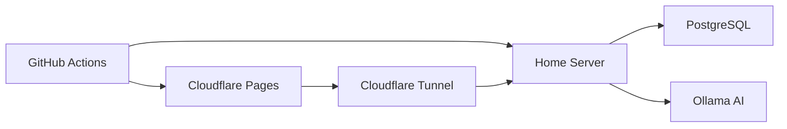

# Menlo GitHub Actions Workflows

This directory contains the CI/CD workflows for the Menlo Home Management application, implementing the hybrid cloud-local architecture defined in [ADR-001](../../docs/decisions/adr-001-hosting-strategy.md).

## 🔄 Workflow Overview

### Continuous Integration (CI)

**File**: `ci.yml`

Comprehensive CI pipeline that runs on every push and pull request:

- **Change Detection**: Intelligently detects which parts of the codebase changed
- **Backend Testing**: .NET tests with PostgreSQL, security scanning with CodeQL
- **Frontend Testing**: Angular tests, builds, and Storybook generation
- **Integration Testing**: End-to-end testing across the full stack
- **Documentation**: Markdown linting and link checking
- **Container Image**: Builds the arm64 `menlo-api` image on every PR (no push) and pushes `sha-<full commit sha>` on `main` for CD to deploy
- **Quality Gate**: Required status check that blocks merging (including Dependabot auto-merge) unless every job succeeded or was skipped by change detection

### Continuous Deployment (CD)

**Frontend Deployment**: `cd-frontend.yml`

- Deploys Angular PWA to Cloudflare pages
- Includes Storybook documentation deployment
- Configures routing for API proxy to home server

**Backend Deployment**: `cd-backend.yml`

- Starts when CI succeeds on `main` and deploys the exact image CI built for that commit (`menlo-api:sha-<full commit sha>`); it never builds images itself
- Skips commits that produced no image (e.g. docs-only); a manual run redeploys production, or deploys a given `sha` for rollback
- Deploys to the Linux home server through the `menlo-deploy` self-hosted runner (bash steps, see [ADR-004](../../docs/decisions/adr-004-linux-deployment-host.md))
- Manages PostgreSQL and Ollama containers
- Configures Cloudflare Tunnel integration

### Dependency Management

**File**: `dependency-updates.yml`

Automated dependency maintenance:

- **Weekly Updates**: Checks for .NET and frontend dependency updates
- **Security Audits**: Scans for vulnerable packages
- **Automated PRs**: Creates pull requests for safe updates
- **Issue Creation**: Creates security issues for vulnerable dependencies

## 🏗️ Architecture Alignment

These workflows implement the **Hybrid Cloud-Local Architecture**:



### Cost Optimization

- **Frontend**: Cloudflare Pages
- **Backend**: Home server deployment with minimal cloud costs
- **Container Registry**: Free GitHub Container Registry
- **CI/CD**: GitHub Actions free tier (generous limits)

### Security Features

- **No Exposed Ports**: Cloudflare Tunnel eliminates need for static IP
- **Container Security**: Trivy scanning and minimal attack surface
- **Dependency Auditing**: Automated vulnerability detection
- **Self-Hosted Runner**: Direct deployment without SSH keys or remote access
- **Branch Protection**: GitHub's branch protection provides deployment security
- **Secure Secret Management**: Deployment credentials managed through GitHub Actions

## 🛡️ Branch Protection

The **Protected Branches** ruleset (default branch and `release/**`) requires a pull request and a passing `Quality Gate` check from GitHub Actions, with no bypass actors. Its definition lives in [`.github/rulesets/protected-branches.json`](../rulesets/protected-branches.json). After changing it, apply it with:

```shell
gh api -X PUT repos/DigiBanks99/menlo/rulesets/7452579 --input .github/rulesets/protected-branches.json
```

The required check matches the job name, so renaming the `Quality Gate` job in `ci.yml` means updating the ruleset too. The job runs with `if: always()`, so docs-only PRs still get a status when the path-filtered jobs are skipped.

## 🔧 Required Secrets

Configure these secrets in GitHub repository settings:

### Backend Deployment

- `POSTGRES_USER`: PostgreSQL username  
- `POSTGRES_PASSWORD`: PostgreSQL password

> **Note**: The backend deployment uses a self-hosted GitHub Actions runner on the Linux home server, with direct line-of-sight to local services.  
> SSH-based deployment has been replaced with direct local execution for improved security and simplicity.

### Frontend Deployment

- `CLOUDFLARE_API_TOKEN`: Cloudflare Pages deployment token
- `CLOUDFLARE_ACCOUNT_ID`: Cloudflare account identifier

## 📊 Required Variables

Configure these variables in GitHub repository settings:

### Application Configuration

- `API_BASE_URL`: Base URL for the API (e.g., `https://menlo.yourdomain.com`)
- `FRONTEND_URL`: Production URL (API with the bundled SPA); CD smoke-checks it after every deploy
- `CLOUDFLARE_PAGES_PROJECT_NAME`: Frontend Cloudflare project name (e.g., `menlo-ui-web`)

### Optional Features

- `DEPLOY_STORYBOOK`: Set to `true` to enable Storybook deployment
- `STORYBOOK_URL`: Storybook documentation URL
- `CONTAINER_RUNTIME`: `docker` or `podman` on the deploy host (unset auto-detects, preferring Podman)
- `CLOUDFLARE_TUNNEL_ENABLED`: Set to `true` if using Cloudflare Tunnel
- `FEATURES_BUDGET`: Set to `true`/`false` to control budget endpoints in production

## 🚀 Deployment Process

### Development Workflow

1. **Feature Development**: Create feature branch
2. **Automated Testing**: CI runs on every push
3. **Code Review**: Pull request with automated checks
4. **Merge to Main**: Triggers production deployment

### Production Deployment

1. **Frontend**: Automatically deployed to Cloudflare Pages
2. **Image**: CI's `Container Image` job pushes `menlo-api:sha-<full commit sha>` (arm64) for commits on `main`
3. **Backend**: CD deploys that exact image to the home server once CI succeeds, then moves the `main` tag to it
4. **Health Checks**: The deploy job fails if `/health` never returns 200 on the host; then `deployment/smoke-check.sh` checks `FRONTEND_URL` from outside, and the `main` tag only moves if it passes
5. **Rollback**: Re-run CD for an earlier commit: `gh workflow run cd-backend.yml --ref main -f sha=<full sha>`

There are no versioned releases; every successful commit on `main` that changes the image is deployed.

## 🔍 Monitoring and Observability

### Workflow Monitoring

- **GitHub Actions**: Built-in workflow monitoring and logs
- **Deployment Status**: Environment status tracking
- **Artifact Storage**: Release artifacts and test results

### Application Monitoring

- **Health Checks**: Automated endpoint monitoring
- **Container Health**: Docker container health monitoring
- **Log Aggregation**: Centralized logging via Docker

## 🛠️ Local Development

To test workflows locally:

```bash
# Install act for local GitHub Actions testing
# https://github.com/nektos/act

# Test CI workflow
act push

# Test with specific event
act push --eventpath .github/test-events/push.json
```

## 📚 Related Documentation

- [Hosting Strategy ADR](../../docs/decisions/adr-001-hosting-strategy.md) - Architecture decisions
- [Implementation Roadmap](../../docs/requirements/implementation-roadmap.md) - Development plan
- [Architecture Document](../../docs/explanations/architecture-document.md) - System architecture

---

*These workflows implement the cost-conscious, privacy-first architecture defined for the Menlo Home Management application, balancing automation with operational simplicity.*
