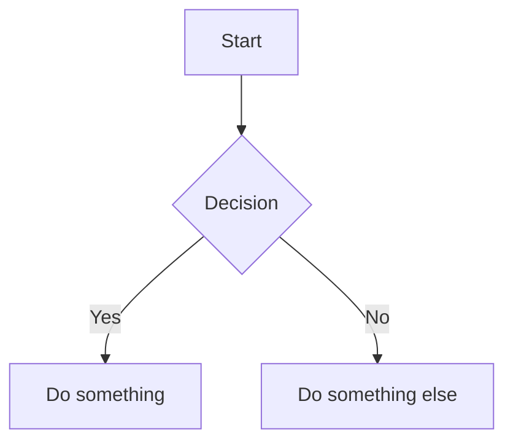

# Menlo Home Management - Documentation Index

## 📝 Documentation Strategy

Menlo uses a customized version of the [Divio documentation system](https://docs.divio.com/documentation-system/) to ensure clarity, consistency, and rapid context gathering for both humans and LLM agents. All documentation is written in Markdown and organized for future deployment as a GitHub Page.

### Documentation Types & Locations

| Type                     | Purpose/Why                                                              | Location/Where                                        | Format           |
| ------------------------ | ------------------------------------------------------------------------ | ----------------------------------------------------- | ---------------- |
| **Tutorials**            | Step-by-step guides for onboarding, new features, and workflows.         | `/docs/tutorials/`                                    | Markdown         |
| **How-to Guides**        | Task-focused instructions for specific use cases and integrations.       | `/docs/guides/`                                       | Markdown         |
| **Technical Reference**  | API, architecture, domain models, configuration, and code-level details. | `/docs/reference/`                                    | Markdown         |
| **Explanations**         | Rationale, design decisions, philosophy, and context for choices.        | `/docs/explanations/`                                 | Markdown         |
| **Requirements & Specs** | Intent: what and why, how to build each slice, and its test cases.       | GitHub issues ([Work Items](reference/work-items.md)) | Issue forms      |
| **Diagrams**             | C4, process, sequence, and flowcharts for architecture and workflows.    | `/docs/diagrams/`                                     | Mermaid/Markdown |
| **Decisions**            | Architectural decisions, rationale, and TODOs for traceability.          | `/docs/decisions/`                                    | Markdown         |
| **Snapshots**            | Context captures for LLM/agent fast reference and debugging.             | `/docs/snapshots/`                                    | Markdown         |

### Diagramming Standard

- **All diagrams must use [Mermaid](https://mermaid-js.github.io/mermaid/#/) syntax embedded in markdown files.**
- Mermaid is preferred for its native markdown compatibility and seamless rendering on GitHub Pages.
- Store as-built diagrams in `/docs/diagrams/` as `.md` files containing Mermaid code blocks. Diagrams for planned work go in the Spec issue.

Example:

### Issues Hold Intent, Docs Hold As-Built Truth

Planned work lives in GitHub issues on the [Menlo Roadmap](https://github.com/users/DigiBanks99/projects/2) project, in three levels. See [Work Items](reference/work-items.md) for the full model.

- **Requirement** (`requirement`): what and why, with acceptance criteria.
- **Spec** (`spec`, a sub-issue of a Requirement): how to build one slice, with its test cases and diagrams.
- **Task** (`task`, a sub-issue of a Spec): only when a Spec is too big for one PR.

There are no implementation plans; whoever picks up a Spec plans it then. Once work ships, `docs/` describes how it works, and the issue is not updated again. [Work Items](reference/work-items.md) also holds the Definitions of Ready and Done.

> `docs/requirements/` predates this model. Shipped modules are being distilled into as-built docs and unshipped ones moved to issues (#494, #496); don't add new folders there.

### Consistency Guidelines

- Always use Markdown for documentation.
- Use Mermaid for all diagrams
- Follow [Divio](https://docs.divio.com/documentation-system/) tier model, extended for LLM/agent and snapshot needs.
- Use clear, concise, and testable language.
- Reference existing docs—never duplicate sections.
- Store diagrams in the correct folder and link them in requirements/issues.
- Use quote blocks for gotchas and edge cases.
- Update documentation as features evolve and decisions are made.

### Why This Structure?

- Enables fast onboarding and context gathering for humans and agents.
- Supports traceability from requirements to code, tests, and decisions.
- Ensures documentation is always up-to-date, deployable, and actionable.
- Facilitates future automation, debugging, and LLM/agent workflows.

---

## 📋 Essential Documentation

### 🎯 Core Documents

- **[Concepts & Terminology Guide](explanations/concepts-and-terminology.md)** - Start here! Core philosophy, design patterns, and terminology
- **[Work Items](reference/work-items.md)** - Requirements, Specs and Tasks in GitHub issues, with the Definitions of Ready and Done
- **[Business Requirements](requirements/business-requirements.md)** - Complete feature specifications with AI integration
- **[User Onboarding Flow](requirements/onboarding.md)** - First-login provisioning, household selection, and extensible task system
- **[Architecture Decision Record](decisions/adr-001-hosting-strategy.md)** - Hosting strategy analysis and decision rationale
- **[ADR-005: Bundled SPA Hosting](decisions/adr-005-bundled-spa-hosting.md)** - Why the API image serves the frontend

### 🏗️ Architecture & Design

- **[C4 Context Diagram](diagrams/c4-context-diagram.md)** - System overview and user interactions
- **[C4 Component Diagram](diagrams/c4-component-diagram.md)** - Internal system architecture
- **[C4 Code Diagram](diagrams/c4-code-diagram.md)** - Detailed domain model and entity relationships

### 🛠️ How-to Guides

- **[Use Domain Abstractions](guides/domain-abstractions-howto.md)** - Practical examples for using core domain abstractions
- **[Add Authorization Policy](guides/auth-policy-howto.md)** - Define new roles and policies
- **[Add Angular Auth Guard](guides/angular-auth-guard-howto.md)** - Create route guards for role-based access

### 📚 Tutorials

- **[Building a Domain Model](tutorials/domain-abstractions-tutorial.md)** - Step-by-step guide to creating a rich domain model
- **[Secure Minimal API](tutorials/secure-api-tutorial.md)** - Create a secured API endpoint with policies

### 📖 Technical Reference

- **[Domain Abstractions API](reference/domain-abstractions-api.md)** - API reference for Entity, AggregateRoot, and Value Objects
- **[Authentication API](reference/authentication-api.md)** - API reference for AuthError, User, and Policies

### 📊 Project Status

- **[Menlo Roadmap](https://github.com/users/DigiBanks99/projects/2)** - GitHub Project tracking requirements, specs and tasks by phase and status

## 🧠 Key Concepts Quick Reference

| Concept                            | Description                                             | Document                                                                                                   |
| ---------------------------------- | ------------------------------------------------------- | ---------------------------------------------------------------------------------------------------------- |
| **Blueberry Muffin AI**            | AI embedded throughout workflows, not separate features | [Concepts Guide](explanations/concepts-and-terminology.md#the-blueberry-muffin-approach-to-ai-integration) |
| **CFO-COO Dynamic**                | Strategic vs operational family roles                   | [Concepts Guide](explanations/concepts-and-terminology.md#the-cfo-coo-family-dynamic)                      |
| **Natural Workflow Preservation**  | Enhance existing habits, don't replace them             | [Concepts Guide](explanations/concepts-and-terminology.md#natural-workflow-preservation)                   |
| **Privacy-First Local AI**         | All AI processing on home server                        | [Concepts Guide](explanations/concepts-and-terminology.md#privacy-first-local-ai)                          |
| **Hybrid Cloud-Local**             | Cloudflare Tunnel + home server (API with bundled SPA)  | [ADR-005](decisions/adr-005-bundled-spa-hosting.md)                                                        |
| **Cost-Conscious Experimentation** | Low-cost validation approach                            | [Concepts Guide](explanations/concepts-and-terminology.md#cost-conscious-experimentation)                  |
| **User Onboarding Flow**           | First-login provisioning and household setup            | [Onboarding](requirements/onboarding.md)                                                                   |

## 🛤️ Reading Paths

### For Developers

1. [Concepts & Terminology Guide](explanations/concepts-and-terminology.md) - Understand the philosophy
2. [Work Items](reference/work-items.md) - Start here: how requirements, specs and tasks flow through the [Menlo Roadmap](https://github.com/users/DigiBanks99/projects/2)
3. [Business Requirements](requirements/business-requirements.md) - Learn the features
4. [User Onboarding Flow](requirements/onboarding.md) - Understand first-login experience and authentication
5. [C4 Component Diagram](diagrams/c4-component-diagram.md) - Understand the architecture
6. [C4 Code Diagram](diagrams/c4-code-diagram.md) - Understand the domain model
7. [ADR-001](decisions/adr-001-hosting-strategy.md) - Know the infrastructure decisions

### For New Team Members

1. [Concepts & Terminology Guide](explanations/concepts-and-terminology.md) - Essential philosophy
2. [C4 Context Diagram](diagrams/c4-context-diagram.md) - System overview
3. [Business Requirements](requirements/business-requirements.md) - What we're building

## 🎨 Design Philosophy Highlights

### The "Blueberry Muffin" Approach

> "AI agents embedded seamlessly into existing workflows, like blueberries distributed throughout a muffin, rather than existing as separate, distinct features."

**Key Benefits:**

- ✅ Zero learning curve for primary workflows
- ✅ Non-intrusive background enhancement
- ✅ Contextual cross-domain intelligence
- ✅ Natural family workflow preservation

### Family-Centric Design

- **Wife's Role**: Operational planning with handwritten lists preserved
- **Husband's Role**: Strategic financial analysis and planning
- **Shared Goals**: Budget coordination and family scheduling

### Technical Excellence

- **Local AI**: Privacy-first with Ollama and Microsoft Phi models
- **Cost Control**: ~80% savings vs full cloud hosting
- **South African Context**: Load shedding resilience and local infrastructure considerations

## 📈 Architecture Evolution

| Phase                 | Status      | Focus                                          |
| --------------------- | ----------- | ---------------------------------------------- |
| **Documentation**     | ✅ Complete | Requirements, architecture, and philosophy     |
| **Infrastructure**    | 🔄 Next     | Cloudflare Tunnel, PostgreSQL, Ollama setup    |
| **MVP Development**   | ⏳ Planned  | Handwritten list capture and AI interpretation |
| **Family Validation** | ⏳ Future   | Real family usage testing and feedback         |

## 🔗 External References

- **Microsoft Semantic Kernel**: AI orchestration framework
- **Ollama**: Local AI model hosting
- **Cloudflare Tunnel**: Secure home server connectivity
- **Bundled SPA**: The API image serves the Angular frontend ([ADR-005](decisions/adr-005-bundled-spa-hosting.md))

---

This documentation represents a comprehensive foundation for building an AI-enhanced family home management application that respects natural workflows while providing intelligent automation.
