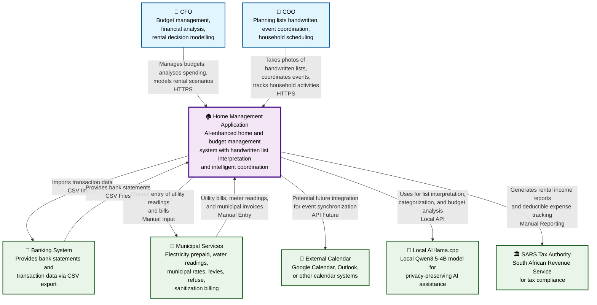

# Home Management Application - System Context Diagram

This diagram shows the high-level system context for the Menlo Home Management Application, illustrating the main users, the system itself, and external systems it integrates with.

## Architecture Notes

### Hybrid Architecture

- **Frontend**: Bundled in the API image, served from the home server ([ADR-005](../decisions/adr-005-bundled-spa-hosting.md))
- **Backend**: Home server via Cloudflare Tunnel  
- **Database**: PostgreSQL
- **AI**: Local llama.cpp with Qwen3.5-4B
- **Cost**: ~R165-365/month

### User Roles

#### CFO

- Budget analysis with AI insights
- Rental income modelling  
- Financial reporting
- Expense attribution
- Bank reconciliation
- Transaction categorization

#### COO

- Handwritten list capture & AI interpretation
- Budget impact awareness
- Event coordination
- Household scheduling

### Privacy-First AI

- All processing local
- No external AI costs
- User correction learning
- Qwen3.5-4B for chat and vision (llama.cpp)

### Financial Integration

- CSV import with duplicate detection
- AI-powered categorization
- Smart attribution suggestions  
- Automatic reconciliation matching
- Support for major SA banks

### SA Municipal Services

- Prepaid electricity top-ups
- Monthly water meter readings
- Municipal rates & levies (separate invoices)
- Gas refills (6-8 month intervals)
- Fibre internet billing
- Rental vs house attribution focus
