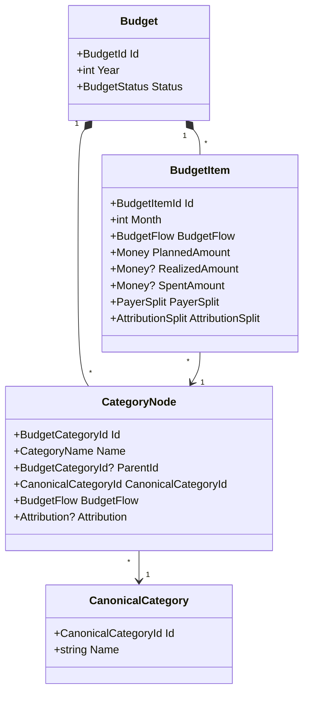
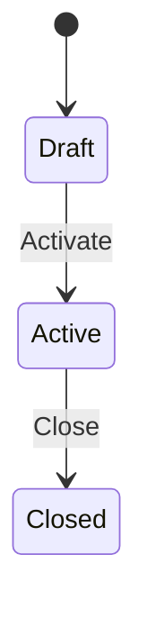

# Budget Domain

This page explains the budget model as shipped: what a budget is, how its categories and items fit together, and the rules the domain enforces. The endpoints are in [Budget API](../reference/budget-api.md).

> Budget items are being redesigned on the [Budgeting and spend map](https://github.com/DigiBanks99/menlo/issues/594). This page describes the code as it is today, not the redesign.

The code is in `src/lib/Menlo.Lib/Budget/`; persistence is in `src/lib/Menlo.Application/Budget/`.

## The shape of a budget

- A **Budget** is a household's plan for one calendar year. It is the aggregate root: categories and items change only through its methods.
- A **CategoryNode** groups items. Categories hold no amounts themselves.
- A **BudgetItem** is the amount for one leaf category in one month (1 to 12).
- A **CanonicalCategory** gives a category a stable identity across years, so this year's "Groceries" and last year's are known to be the same thing.

`Budget`, `CategoryNode` and `BudgetItem` are auditable and soft-deletable. `CanonicalCategory` is auditable only. All amounts are ZAR [`Money`](../reference/money-api.md).

## Budgets

- **One per year.** A unique index on year enforces it, and creating a budget for a year that already has one returns the existing budget.
- **Only this year or next.** The API creates budgets for the current year or the following one.
- **A new year starts from the last one.** If the previous year has a budget, the new budget copies its category tree, keeping each category's `CanonicalCategoryId` and skipping deleted categories. The domain's `CloneForYear` can also copy items, but the API doesn't load them, so items are not copied. Otherwise the budget starts empty.

### Status

- A budget starts as **Draft**.
- **Activate** makes it the live plan. Only a Draft budget can be activated. Activating a budget closes the previous year's budget if that one is Active.
- **Close** is only reached that way; there is no endpoint to close a budget directly.

Status doesn't restrict editing. Categories and items can be changed in a budget of any status.

## Categories

- **Two levels.** A category is a root or a child of a root. A child can't have children, and a root with children can't be moved under another category.
- **Unique among siblings.** Names are trimmed, can't be empty, and must be unique among the non-deleted categories with the same parent, ignoring case.
- **Flow.** `BudgetFlow` says whether a category holds `Income`, `Expense` or `Both` kinds of items.
- **Metadata** to help when drafting: an optional `Attribution` (`Main`, `Rental` or `ServiceProvider`), `Description`, `IncomeContributor` and `ResponsiblePayer`. The last two are free text.
- **Moving.** A category can be moved under another root, or promoted to a root, within the rules above.
- **Deleting is soft, and cascades.** Deleting a category also deletes its children. Restoring it restores its children. A child can't be restored while its parent is deleted. Deleting or restoring twice does nothing.

Each new category gets a new `CanonicalCategory` with the same name. Categories copied into a new year keep their canonical category instead.

## Items

- **Leaf categories only.** An item can only belong to a category that has no non-deleted children.
- **One per category per month.** A second item for the same category and month is rejected. A unique index, ignoring deleted items, backs this up.
- **Income or expense.** An item's flow is `Income` or `Expense`, never `Both`, and must match its category's flow unless the category allows `Both`.
- **Planned, realized, spent.** Each item has three amounts:
  - **Planned:** what the household expects. Always set.
  - **Realized:** what the bill or payslip says, once it arrives. Optional.
  - **Spent:** what actually moved. Optional. An item can go straight from planned to spent.
- **Amounts aren't range-checked.** Zero and negative amounts are accepted.
- **Splits.** Every item has two splits. Each split's percentages must be positive whole numbers that add up to 100, with no duplicates:
  - The **payer split** is who pays, as percentages per user.
  - The **attribution split** is who the cost is for, as percentages per `Attribution`. It is what separates household costs from rental costs.
- **Deleting is soft and final.** A deleted item can't be restored. That is a deliberate choice.

### Planning many months at once

- **Bulk create** adds an item, with the same amount and splits, to every month of a leaf category that doesn't have one yet.
- **Fill forward** sets the amount and splits for every month from a start month to December. It creates the missing items and overwrites the planned amount on the existing ones.

### Events

The aggregate raises an event for each change, such as `BudgetCreatedEvent`, `BudgetActivatedEvent`, `BudgetCategoryAddedEvent`, `BudgetItemPlannedEvent`, `BudgetItemRealizedEvent` and `BudgetItemSpentEvent`. A change to an existing item's amount raises `BudgetItemCorrectedEvent`, with the field name and the old and new amounts. Nothing handles these events yet.

## Summary

The summary for a budget, for one month or the whole year, groups items by root category, separately for income and expense.

- A root's totals include its own items and its children's.
- Categories with nothing planned, realized or spent are left out.
- **Net planned** is income minus expenses.
- **Net realized** and **net spent** are null until at least one item has a realized or spent amount.
- `Both` categories appear on both sides, each showing only its items of that flow.

## Feature flags

The budget endpoints are behind configuration flags, and return `404` when a flag is off:

- `Features:Budget` turns on budgets and categories.
- `Features:BudgetItems` turns on items and the summary.

`Menlo:SeedDemoBudget` seeds a demo budget for the current year at startup.
