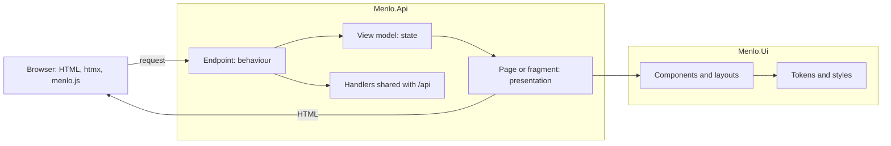

# UI Architecture

Menlo's UI is HTML rendered by the API. The server decides what a page says; the browser shows it and asks for more. This document explains the parts, where each kind of code lives, and why. The decision behind it is [ADR-007](../decisions/adr-007-server-rendered-ui.md).

## The parts



| Part | Where | What it is |
| --- | --- | --- |
| Design system | `src/ui/Menlo.Ui` | Tokens, components, layouts, charts and the gallery. It knows nothing about budgets or the API. |
| Pages | `src/api/Menlo.Api/Ui/<Feature>` | A feature's endpoints, view models, pages and fragments. |
| Shared UI plumbing | `src/api/Menlo.Api/Ui/Shared` | Rendering, toasts, htmx response headers, form errors and the page frame. |

## Pages, fragments, components and utilities

Every piece of UI code is one of four things. The names tell you which.

| Kind | It is | It may | It may not |
| --- | --- | --- | --- |
| **Page** (`*Page.razor`) | A whole screen at an address | Compose components and fragments; take a view model | Load data, inject services, decide rules |
| **Fragment** (any other `.razor` in a feature folder) | A part of a page the server can send on its own: a form, a panel, a list | The same as a page | The same as a page |
| **Component** (`Mnl*.razor` in `Menlo.Ui`) | A reusable piece of presentation: a button, a card, a field | Take simple parameters and child content | Know about budgets, routes, the signed-in user or the API |
| **Utility** (a static class) | A pure function: formatting money, building a class name, chart arithmetic | Compute | Render markup or hold state |

A page and a fragment differ only in how they are sent. A page is rendered inside the document (`Render.Page`); a fragment is sent alone for htmx to swap in (`Render.Fragment`).

## State, behaviour and presentation

Each lives in one place.

- **State** is a **view model**: an immutable record with everything a page needs, already formatted. A home page `HomeStat` carries `Value` ("R 12 000"), `Trend` ("+4.8% vs last month") and `Tone` (`Success`), not the raw amounts.
- **Behaviour** is an **endpoint** and the code it calls. It reads the request, calls the same handlers as the JSON API, applies the rules, builds the view model and chooses the response.
- **Presentation** is a **`.razor` file** and its `.razor.css`. It turns a view model into markup and nothing else.

The test for a `.razor` file: it has no `@inject`, no `if` that encodes a rule ("95% and above is an error"), and no formatting of numbers or dates. If it needs any of those, the view model is missing a property.

This split is what makes the UI testable at three speeds. A view model builder is tested as a function. An endpoint is tested by asking for the page and reading the HTML. A component is tested by rendering it with parameters.

## Where the page's state lives

A page's state is in its URL. The analytics page's viewing period is a query-string parameter (`period`). So:

- A reload, the back button and a shared link show the same thing.
- The server needs no session state for the UI.
- A part of the page refreshes by asking for the page again at the new address and taking its own part of the answer (`hx-select`). There is one endpoint and one view model builder to keep right.

Only presentation state stays in the browser: the theme, whether a disclosure is open, the text in a field before it is submitted.

## How a change reaches the screen

```mermaid
sequenceDiagram
    participant Browser
    participant Endpoint
    Browser->>Endpoint: POST the form (htmx)
    alt the input is invalid
        Endpoint-->>Browser: 422 and the form with its errors
        Note over Browser: the form replaces itself
    else the change is saved
        Endpoint-->>Browser: 204 and an HX-Trigger header
        Note over Browser: toast shown, panel closed, "things-changed" raised
        Browser->>Endpoint: GET the page (the region listens for the event)
        Endpoint-->>Browser: the page; the region swaps itself
    end
```

An endpoint that changes data doesn't know which parts of the page show it. It raises an event (a name in `UiEvents`), and the regions that care reload themselves. Adding a new place that shows the data means adding a listener, not changing every endpoint.

Requests that swap the same region are synchronised: a newer one replaces an older one still in flight, so a slow reload can't overwrite a newer filter.

## Client script

`menlo.js` is the only script the app owns. It handles presentation behaviour that needs no data from the server: switching the theme, opening a panel when it arrives, showing a toast, adding a row to a repeated field and keeping its total up to date. It finds elements by `data-mnl-*` attributes.

If a behaviour needs data, it is an htmx request and the server renders the result. That rule keeps business logic out of the browser.

## Security

- **Content Security Policy.** `script-src 'self'; style-src 'self'`. Markup has no inline `<script>`, `style=""` or `on*=""`. Sizes and colours that vary come from attributes and classes (`data-tone="warning"`, `<progress value>`, SVG attributes).
- **Anti-forgery.** Every UI request that changes data must carry the anti-forgery token. `menlo.js` adds it to htmx requests as the `X-XSRF-TOKEN` header.
- **Authorization.** UI endpoints use the same policies as the API. Someone who isn't signed in is sent to `/sign-in`; someone without the role sees a "no access" page.
- **htmx inheritance is off.** An `hx-*` attribute affects only the element it is on, so a region's `hx-select` can't change what a button inside it does.

## Server push

Slow work, such as processing a photo of a shopping list, will report back over server-sent events. htmx's SSE extension is vendored; a page turns it on with `ServerSentEvents="true"` on `MnlDocument` and listens with `hx-ext="sse"`. The server sends HTML fragments as events, so the same components render pushed updates. No page uses it yet.

## Related

- [Design System](../reference/design-system.md): the tokens and components
- [App Shell](../reference/app-shell.md): the frame around every page
- [How to add a page](../guides/ui-page-howto.md)
- [How to write .NET tests](../guides/testing-howto.md#test-the-ui)
