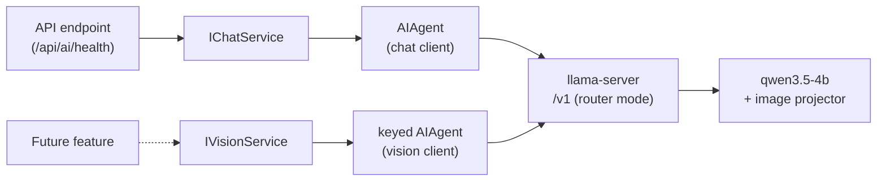

# AI Services

`Menlo.AI` gives the API a chat service and a vision service, both backed by a local llama.cpp `llama-server` through its OpenAI-compatible API. It uses Microsoft Agent Framework (`Microsoft.Agents.AI`) and `Microsoft.Extensions.AI`. Why llama.cpp and Agent Framework, and not Ollama and Semantic Kernel, is in [ADR-006](../decisions/adr-006-llamacpp-and-agent-framework.md).

No feature calls these services yet. The only caller is the `/api/ai/health` endpoint.

## How a call flows

## Registration

`Program.cs` calls `builder.AddMenloAi()` (`Menlo.AI.Extensions`). It registers:

| Service                                      | Lifetime  | What it is                                                                                     |
| -------------------------------------------- | --------- | ---------------------------------------------------------------------------------------------- |
| `IChatClient`                                | Singleton | OpenAI chat client for `ChatModel`                                                             |
| `AIAgent`                                    | Singleton | Agent over that chat client                                                                    |
| `AIAgent` keyed `Menlo.AI.Vision`            | Singleton | Agent over a separate client for `VisionModel`, with a longer network timeout and no retries   |
| `IChatService` → `ChatService`               | Scoped    | Text prompts                                                                                   |
| `IVisionService` → `VisionService`           | Scoped    | Image prompts                                                                                  |

The OpenAI client uses its own HTTP transport, not `IHttpClientFactory`, so the service defaults' resilience handler doesn't apply to model calls. If a `System.ClientModel.Primitives.PipelineTransport` is registered, both clients use it; the tests register a stub server this way.

Startup only validates configuration. It doesn't contact the model server, so the API starts and serves budgets while `llama-server` is down.

## Configuration

Settings bind from `Menlo:AI` (`AiSettings`) and are validated on start.

| Key                       | Default      | Rule                                                                                                    |
| ------------------------- | ------------ | ------------------------------------------------------------------------------------------------------- |
| `Menlo:AI:Endpoint`       | none         | Required. Absolute `http` or `https` URL, including `/v1`                                               |
| `Menlo:AI:ChatModel`      | `qwen3.5-4b` | Required. A model name the server serves (a section of its preset file)                                 |
| `Menlo:AI:VisionModel`    | `qwen3.5-4b` | Required. Separate from `ChatModel` so vision can move to another model; the model needs its projector |
| `Menlo:AI:ApiKey`         | none         | The server's `--api-key`. When blank, the client sends `no-key`, which llama.cpp ignores unless it has a key |
| `Menlo:AI:EnableThinking` | `false`      | When false, each request sends `chat_template_kwargs.enable_thinking = false`                           |
| `Menlo:AI:VisionTimeout`  | 10 minutes   | Positive, at most one day. Matches `llama-server`'s 600 s `--timeout` on the home server                 |

## `IChatService`

- `GetResponseAsync(prompt, cancellationToken)` returns the whole answer, or an empty string.
- `GetStreamingResponseAsync(prompt, cancellationToken)` yields the answer's text as it arrives.

Chat calls use the OpenAI client's defaults: a 100 s network timeout and its retry policy.

## `IVisionService`

- `AnalyzeImageAsync(imageData, mediaType, prompt, cancellationToken)` asks the vision model about an image.
- `ExtractTextAsync(imageData, mediaType, cancellationToken)` transcribes hand-written text with a fixed prompt. It keeps line breaks and writes `[illegible]` for words the model can't read.

Both send the prompt and the image as one user message. They throw:

- `ArgumentException` when the image is empty, the media type isn't `image/jpeg`, `image/png` or `image/webp` (case-insensitive), or, for `AnalyzeImageAsync`, the prompt is blank,
- `TimeoutException` when the call runs past `VisionTimeout`. A cancellation from the caller stays an `OperationCanceledException`.

A photo can take minutes on CPU, so run vision calls as background work, not inside a request. The vision client's network timeout is `VisionTimeout` plus one minute, so `VisionService`'s own timeout always fires first, and it never retries a call that already ran to the timeout.

`Menlo.AI` doesn't log prompts, images or answers.

## `/api/ai/health`

`GET /api/ai/health` sends a fixed prompt through `IChatService`. Like every `/api` route it needs a signed-in user.

- `200` with `{ "status": "Healthy", "response": "<the model's answer>" }` when the model answers.
- `500` problem details with `AI service unavailable: <exception message>` when the call fails. The message is there so a wrong API key shows up as `HTTP 401 ... Invalid API Key` (see `deployment/README.md`).

The API's own `/health` doesn't check the model server, so the API stays healthy when AI is down.

## The model server

### Development

The Aspire AppHost runs the `llama` container from `ghcr.io/ggml-org/llama.cpp`, tag `server-b12242` (pinned; it must be new enough for the `qwen35` architecture and MTP speculative decoding). It:

- runs in router mode with `--models-preset /presets/models.ini --models-max 1`, bind-mounting `src/api/Menlo.AppHost/llama/` read-only at `/presets`,
- loads a model on its first request, downloading it from Hugging Face into the persistent `llama-hf-cache` volume the first time,
- is a persistent container with a `/health` check, and the API waits for it,
- runs on CPU only.

The AppHost passes `Menlo__AI__Endpoint` as the container's `http` endpoint plus `/v1` to the API, and to `api-bundled` when `Menlo:BundledUi` is on. It sets no API key.

`llama/models.ini` has one preset, `[qwen3.5-4b]`: `unsloth/Qwen3.5-4B-MTP-GGUF:UD-Q4_K_XL`, Jinja chat templates, a 16384-token context, one parallel slot, the image projector (`mmproj-auto`) and MTP draft decoding. It mirrors the home server's preset.

### Production

Production starts no model server. The API container uses host networking and calls the VM's shared `llama-server` at `http://127.0.0.1:9931/v1`. CD sets the endpoint and model names at the top of `.github/workflows/cd.yml` (`MENLO_AI_ENDPOINT`, `MENLO_AI_CHAT_MODEL`, `MENLO_AI_VISION_MODEL`) and the key from the `MENLO_AI_API_KEY` secret, and fails early when the secret is missing. Setup and troubleshooting are in `deployment/README.md`.

## Tests

- `Menlo.AI.Tests` tests `ChatService` and `VisionService` over a substitute `IChatClient`, and tests the registration and request shape against `StubLlamaServer`, an `HttpMessageHandler` registered through an `HttpClientPipelineTransport`.
- `TestWebApplicationFactory` replaces `IChatService` and `IVisionService` with substitutes unless `UseMockAiServices = false`.
- `AiLiveTests` (`Menlo.Api.Tests`) and `VisionLiveTests` (`Menlo.AI.Tests`) call a real `llama-server`. They're skipped unless `MENLO_AI_LIVE_ENDPOINT` is set to its base URL including `/v1`, for example the Aspire `llama` resource's URL, so CI never needs a model. The vision test can take minutes on CPU.

## Not built yet

[ADR-006](../decisions/adr-006-llamacpp-and-agent-framework.md) leaves two things for later:

- Provenance for each AI suggestion (model, version, timestamp and user) is built with the first feature that produces suggestions.
- Embeddings are dropped until a feature needs them.
