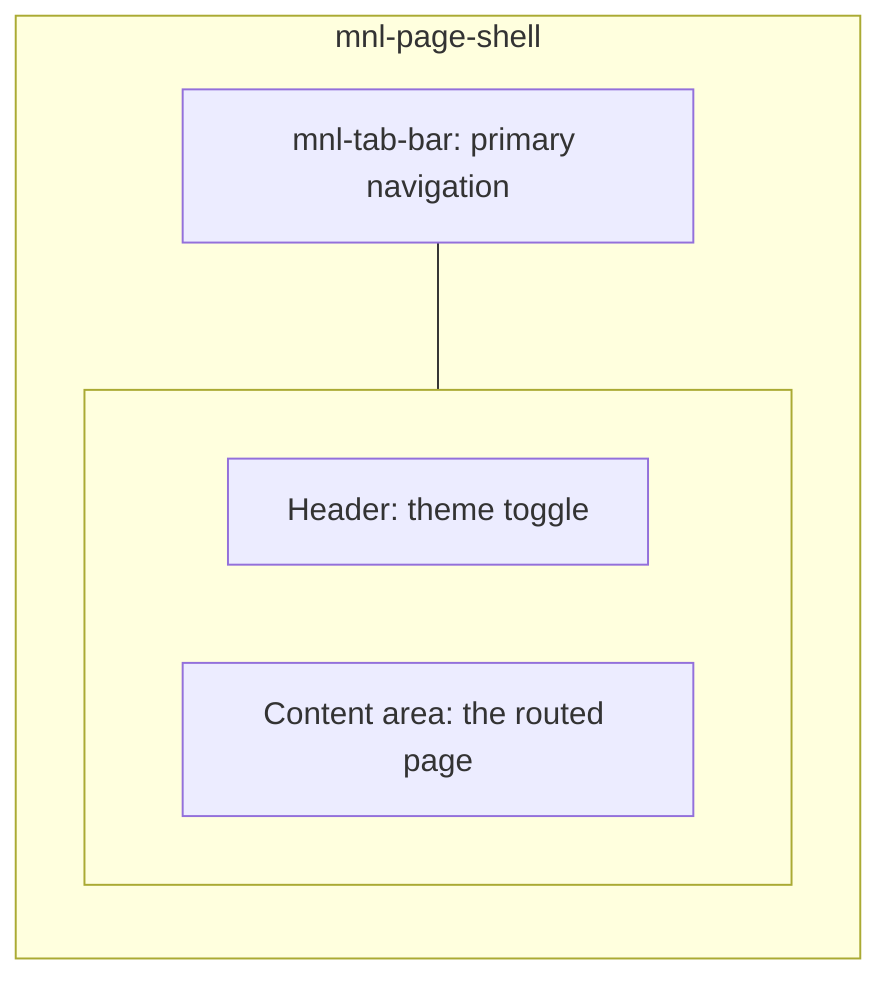

# App Shell Reference

The app shell is the frame around every signed-in page: the primary navigation, a header and the content area. Pages render inside it through the router.

The shell is `MnlPageShellComponent` (`mnl-page-shell`) in `menlo-lib`. The app's root component (`menlo-app/src/app/app.ts`) wraps the `router-outlet` in it.

## When the shell shows

| Route                        | Shell                                                       |
| ---------------------------- | ----------------------------------------------------------- |
| `/sign-in` and `/onboarding` | No shell. The page renders inside a plain `<main>` element. |
| Everything else              | The page renders inside the shell.                          |

The signed-in routes are in `app.routes.ts`: `/` (home), `/budgets`, `/budgets/:id` and `/analytics`. Any other path redirects to `/`. See [Onboarding API](onboarding-api.md#in-the-app) for the guards on them.

## Layout

- **Navigation.** `MnlTabBarComponent` (`mnl-tab-bar`) renders the items it's given twice and shows one at a time:
  - Below the `lg` breakpoint, a tab bar fixed to the bottom of the screen.
  - From `lg` up, a sidebar on the left, with the Menlo name and a short heading.
- **Header.** It holds one control: a button that switches between light and dark mode.
- **Content area.** It scrolls on its own, with the page width capped and padded. It scrolls back to the top after every navigation, and leaves space at the bottom on small screens so the tab bar doesn't cover content.

## Navigation items

The root component passes a fixed list of `MnlTabBarItem`s:

| Label     | Route        | Icon         |
| --------- | ------------ | ------------ |
| Home      | `/`          | `House`      |
| Budgets   | `/budgets`   | `Wallet`     |
| Analytics | `/analytics` | `TrendingUp` |

An `MnlTabBarItem` has an `icon`, a `label`, a `route` and an optional `badge` number, which shows as a count on the icon. Icons are [Lucide](https://lucide.dev) names; the tab bar maps a fixed set of them (`Bell`, `Calendar`, `House`, `Landmark`, `ListTodo`, `PiggyBank`, `Settings`, `TrendingUp`, `User`, `Wallet`).

An item is active when the current URL matches its route: exactly for `/`, and the route or any path under it for the others. The active item is highlighted and has `aria-current="page"`.

Feature flags don't hide items. The list is the same whatever the API's flags are.

## Theme

`ThemeService` (`menlo-lib`) follows the system's `prefers-color-scheme` until someone uses the toggle. Their choice is saved in `localStorage` under `menlo.theme` and wins from then on. The service puts a `dark` class on the `<html>` element and sets its `color-scheme`.

## Toasts

`MnlToastService` (`menlo-lib`) shows non-blocking messages. It creates its own outlet on first use, so the shell doesn't need to include one. Pages use it to confirm actions, for example "Budget 2026 created."

## Accessibility

- Both navigation layouts are `<nav>` elements labelled "Primary navigation".
- The header is a `<header>` element. The theme button's label says what it will do ("Switch to dark mode" or "Switch to light mode").
- Links and buttons have a visible focus ring, and transitions are off when the system asks for reduced motion.
- Inside the shell, the content area is a `
`, not a `<main>` element, and there's no skip-to-content link.

## Not in the shell

The shell has no sign-out control, user menu, breadcrumbs or footer. `AuthService.logout()` exists, but nothing in the app calls it.
