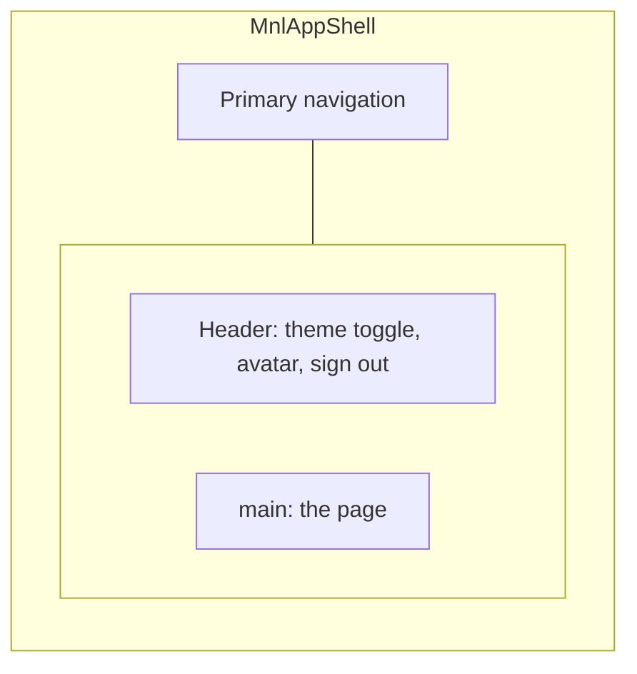

# App Shell Reference

The app shell is the frame around every signed-in page: the primary navigation, a header and the content area.

The shell is the `MnlAppShell` component in `Menlo.Ui`. Pages don't use it directly: they render inside `AppPage` (`src/api/Menlo.Api/Ui/Shared/AppPage.razor`), which wraps the page in `MnlDocument` and `MnlAppShell` and passes on the `PageContext` the endpoint built.

## When the shell shows

| Address | Shell |
| --- | --- |
| `/sign-in`, `/design` | No shell. The page renders inside the document alone (`Bare="true"`). |
| Everything else | The page renders inside the shell. |

The signed-in pages are `/` (home) and `/analytics`. Any other address shows a "not found" page inside the shell. Someone who isn't signed in is sent to `/sign-in`; there is no onboarding step.

## Layout

- **Navigation.** One `<nav>` that CSS lays out two ways:
  - Below 64rem wide, a tab bar fixed to the bottom of the screen.
  - From 64rem up, a sidebar on the left with the Menlo name.
- **Header.** The theme toggle, the signed-in person's avatar (their initials) and a sign-out button.
- **Content area.** A `<main>` element with the page width capped and padded. It leaves space at the bottom on small screens so the tab bar doesn't cover content.

## Navigation items

`PageContext.From` builds the list of `MnlNavItem`s for the request (`PageContext.NavItemsFor`):

| Label | Address | Icon |
| --- | --- | --- |
| Home | `/` | `House` |
| Budgets | `/budgets` | `Wallet` (only while `Features:Budget` is on) |
| Analytics | `/analytics` | `TrendingUp` |

An `MnlNavItem` has a label, an address and an `MnlIconName`. An item is current when the request path matches its address: exactly for `/`, and the address or any path under it for the others. The current item is highlighted and has `aria-current="page"`.

`Features:Budget` hides the Budgets item while it is off. `/budgets` shows the "not found" page until the rebuilt budget adds its page (see [Budget Domain](../explanations/budget-domain.md)).

Links are boosted by htmx: clicking one fetches the page and swaps the body without reloading the document.

## Page context

`PageContext.From(HttpContext)` gives every page:

| Property | What it is |
| --- | --- |
| `CurrentPath` | The request path, for the current navigation item. |
| `UserName` | The signed-in person's display name, or null. |
| `Toasts` | Toasts carried over a redirect by `Flash`. Reading them clears them. |

## Theme

The theme toggle switches between light (Catppuccin Latte) and dark (Catppuccin Mocha). See [Design System](design-system.md#theme).

## Toasts

A toast is a short message that confirms an action and disappears after five seconds, for example "Goal created." At most three show at once. The server sends one in two ways:

- With the response, as an event: `new HxResponse().Toast("Category created.")`.
- Across a redirect: `Flash.Set(context, "Goal created.")`, shown by the next page.

## Panels

The document has a panel host (`#mnl-panel-host`) after the shell. A form or confirmation opens by swapping an `MnlPanel` fragment into it. See [How to add a page](../guides/ui-page-howto.md#add-a-form-in-a-panel).

## Signing out

The sign-out button is a form that posts to `/auth/logout`. It isn't boosted, because the response redirects to Microsoft.

## Accessibility

- The navigation is a `<nav>` labelled "Primary navigation". The page is in `<main>`.
- The header is a `<header>` element. The theme button is labelled "Switch between light and dark mode".
- Links and buttons have a visible focus ring, and transitions are off when the system asks for reduced motion.
- Panels are native `<dialog>` elements, so the browser traps focus and closes them on Escape.
- There is no skip-to-content link yet.

## Not in the shell

The shell has no user menu, breadcrumbs or footer.
