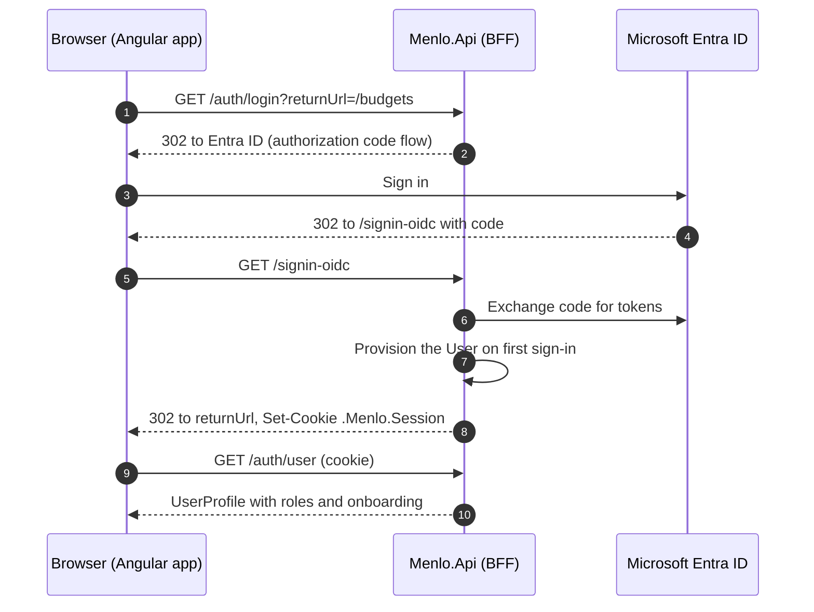
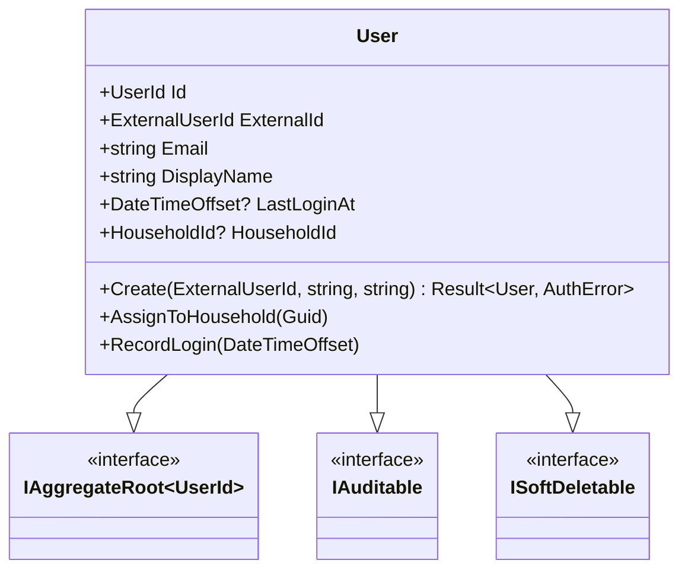

# Authentication API Reference

Menlo signs people in with Microsoft Entra ID, using the free tier. The API is a Backend for Frontend (BFF): it runs the OpenID Connect flow, keeps the tokens on the server and gives the browser only a session cookie. Menlo stores no passwords.

The API also serves the Angular app from the same host (see [ADR-005](../decisions/adr-005-bundled-spa-hosting.md)), so the session cookie and every API call share one origin.

## Sign-in flow



## Configuration

`AddMenloAuthentication()` in `src/api/Menlo.Api/Auth/AuthServiceCollectionExtensions.cs` sets up:

1. **Cookie authentication** as the default scheme.
2. **OpenID Connect** through `Microsoft.Identity.Web` as the challenge scheme, bound to the `AzureAd` configuration section (`MenloAuthOptions`, validated at startup). Tokens are saved in an in-memory token cache, and the `email` scope is always requested.
3. **Authorization policies** through `AddMenloPolicies()`.

The `AzureAd` settings arrive as `AzureAd__*` environment variables. Locally, the AppHost supplies them from Aspire parameters (`azure-ad-*`, with the IDs and client secret marked secret); see `src/api/Menlo.AppHost/EntraIdExtensions.cs`. In production, CD sets them on the container, and the app authenticates to Entra ID with a client certificate rather than a client secret. None of these values reach the browser.

### Session cookie

| Setting    | Value                                   |
| ---------- | --------------------------------------- |
| Name       | `.Menlo.Session`                        |
| HttpOnly   | Yes                                     |
| Secure     | Always                                  |
| SameSite   | `Strict`                                |
| Expiry     | 8 hours, sliding                        |

### API calls get 401, pages get redirected

A request counts as an API call if its path starts with `/api`, it is `GET /auth/user`, it accepts `application/json`, or it has an `X-Requested-With` header. An unauthenticated API call gets `401 Unauthorized`. Any other request is redirected to Entra ID to sign in.

Before redirecting, an `http://` reply address is rewritten to `https://`. A failed remote sign-in is logged and redirects to `/sign-in?error=auth_failed`.

### Anti-forgery

Because the session is a cookie, state-changing API calls need an anti-forgery token:

- On HTTPS `GET`, `HEAD`, `OPTIONS` and `TRACE` requests outside `/auth`, the API sets an `XSRF-TOKEN` cookie that the app can read.
- `POST`, `PUT` and `DELETE` requests under `/api` must send that value in the `X-XSRF-TOKEN` header. Without it, they fail with `400` and a problem-details body.
- The Angular `authInterceptor` adds the header to same-origin `POST`, `PUT` and `DELETE` requests.

## Endpoints

| Endpoint            | Auth                         | Does                                                                                                                                       |
| ------------------- | ---------------------------- | ------------------------------------------------------------------------------------------------------------------------------------------ |
| `GET /auth/login`   | Anonymous                    | Starts sign-in. `returnUrl` must be relative; anything else becomes `/`, which prevents open redirects.                                     |
| `POST /auth/logout` | Signed in                    | Signs out of the cookie and Entra ID sessions, then redirects to `returnUrl`.                                                               |
| `GET /auth/user`    | `RequireAuthenticated`       | Returns the current `UserProfile`. See [Onboarding API](onboarding-api.md#get-authuser).                                                    |

Every endpoint under `/api` requires `RequireAuthenticated`.

## Authorization

Roles are Entra ID App Roles on the app registration, assigned to people in the Enterprise Application. The free tier doesn't support group-based authorization, so Menlo checks roles, not groups. The constants are in `MenloPolicies` (`src/api/Menlo.Api/Auth/Policies/`).

### Roles

| Role Constant                | Value          | Description                 |
| :--------------------------- | :------------- | :-------------------------- |
| `MenloPolicies.Roles.Admin`  | `Menlo.Admin`  | Full system access.         |
| `MenloPolicies.Roles.User`   | `Menlo.User`   | Standard read/write access. |
| `MenloPolicies.Roles.Reader` | `Menlo.Reader` | Read-only access.           |

### Policies

| Policy Name                 | Requirement                                                     |
| :-------------------------- | :-------------------------------------------------------------- |
| `RequireAuthenticated`      | Signed in.                                                      |
| `RequireAdmin`              | `Menlo.Admin`.                                                  |
| `CanEditBudget`             | `Menlo.Admin` or `Menlo.User`.                                  |
| `CanViewBudget`             | `Menlo.Admin`, `Menlo.User` or `Menlo.Reader`.                  |
| `RequireOnboardingComplete` | Signed in, with a provisioned user who has selected a household. |

`RequireOnboardingComplete` is registered but no endpoint uses it yet. Onboarding is enforced in the app by its route guards (see [Onboarding API](onboarding-api.md#in-the-app)).

To protect an endpoint, see [How to apply authorization policies](../guides/auth-policy-howto.md).

## Identity

### User

`User` (`Menlo.Lib.Auth.Entities`) is the aggregate root for a person who signs in. It is auditable and soft-deletable, and is stored in `shared.users` through `IUserContext`.



- `Id`: Menlo's own identifier.
- `ExternalId`: the identifier from Entra ID.
- `HouseholdId`: null until the person creates or joins a household during onboarding.

`RecordLogin` sets `LastLoginAt` and raises `UserLoggedInEvent`, but sign-in doesn't call it yet.

### Provisioning on first sign-in

When Entra ID returns a validated token, `MenloOidcEvents.OnTokenValidated` takes the external ID from the first of these claims that has a value: `nameidentifier`, `oid`, `sub`. It then calls `UserProvisioningService.ProvisionOrUpdateAsync`. If no user has that external ID yet, the service creates one from the token's email and name claims, along with an empty `OnboardingState`. An existing user is left unchanged.

### Resolving the current user

Feature handlers ask `IUserContextProvider` (`Menlo.Lib.Auth.Abstractions`) for the current user. The domain never reads `ClaimsPrincipal`.

```csharp
Task<Result<UserContext, AuthError>> GetUserContextAsync(CancellationToken cancellationToken = default);
```

`UserContextProvider` in `Menlo.Application` takes the external ID from the first of these claims that has a value: `sub`, `oid`, `nameidentifier`, `appid`, `azp`. It then loads the user and returns `UserContext(UserId, HouseholdId)`.

| Situation                                 | Error                             |
| ----------------------------------------- | --------------------------------- |
| No HTTP user, or no identifying claim     | `UnauthenticatedError`            |
| No user with that external ID             | `UserNotFoundError`               |
| The user has no household yet             | `UserNotAssignedToHouseholdError` |

The `/auth/*` endpoints and the onboarding endpoints use the same claim order through `CurrentUserLookup`.

## Errors

`AuthError` (`Menlo.Lib.Auth.Errors`) derives from `Error` and is used with the Result pattern.

| Error                             | Code                             | Meaning                                         |
| --------------------------------- | -------------------------------- | ----------------------------------------------- |
| `UserNotFoundError`               | `Auth.UserNotFound`              | No user matches the external ID.                |
| `UnauthenticatedError`            | `Auth.Unauthenticated`           | Not signed in.                                  |
| `UnauthorisedError`               | `Auth.Unauthorised`              | Not allowed to perform the action.              |
| `ForbiddenError`                  | `Auth.Forbidden`                 | A named policy isn't met.                       |
| `InvalidUserDataError`            | `Auth.InvalidUserData`           | User data failed validation.                    |
| `UserNotAssignedToHouseholdError` | `Auth.UserNotAssignedToHousehold` | The user hasn't joined a household.             |
| `OnboardingIncompleteError`       | `ONBOARDING_INCOMPLETE`          | Onboarding isn't finished.                      |

## In the app

The Angular app (`menlo-app/src/app/core/auth/`) gets its signed-in state from `GET /auth/user`:

- `authGuard` sends a signed-out person to `/sign-in?returnUrl=...`.
- `roleGuard` checks the roles in the route's `data.roles`, and sends a signed-in person without them to `/unauthorized`.
- `authInterceptor` adds the anti-forgery header (see [Anti-forgery](#anti-forgery)).

See [How to use the Angular auth guards](../guides/angular-auth-guard-howto.md).

## Testing signed in

Agents can't complete the Microsoft sign-in, so interactive testing reuses a saved session; see "Signed-in testing" in `AGENTS.md`. Automated end-to-end tests mock the `/auth/*` endpoints instead.
