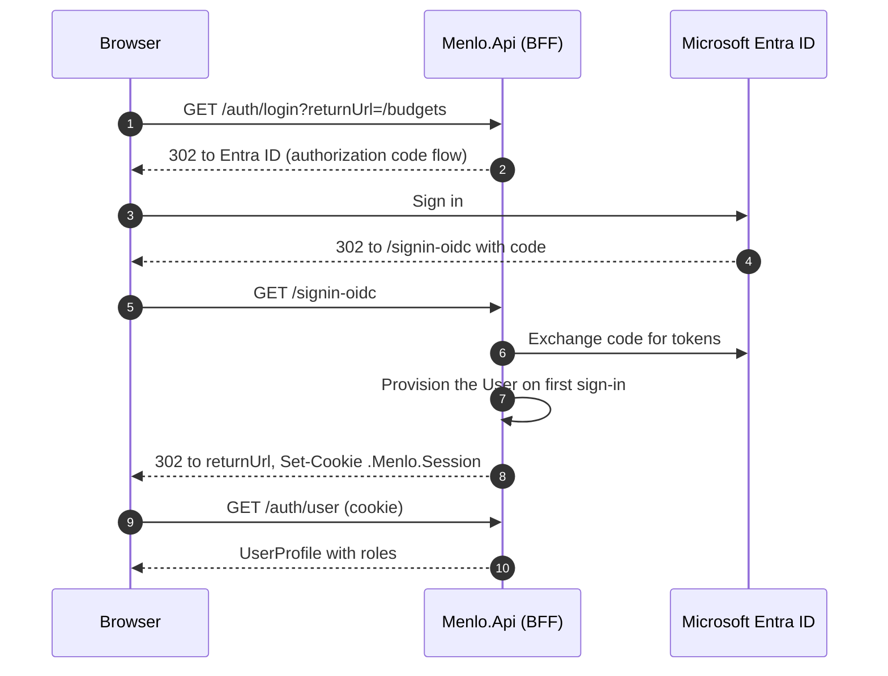
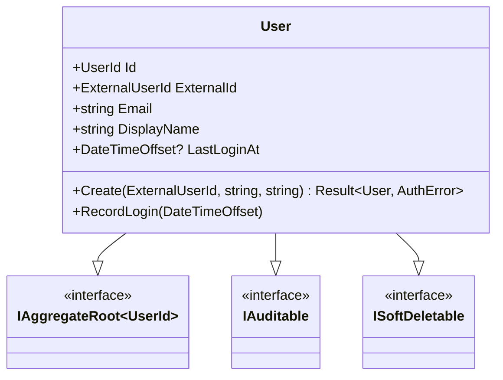

# Authentication API Reference

Menlo signs people in with Microsoft Entra ID, using the free tier. The API is a Backend for Frontend (BFF): it runs the OpenID Connect flow, keeps the tokens on the server and gives the browser only a session cookie. Menlo stores no passwords.

The API also renders the UI (see [ADR-007](../decisions/adr-007-server-rendered-ui.md)), so the session cookie, every page and every API call share one origin.

## Sign-in flow



## Configuration

`AddMenloAuthentication()` in `src/api/Menlo.Api/Auth/AuthServiceCollectionExtensions.cs` sets up:

1. **Cookie authentication** as the default scheme.
2. **OpenID Connect** through `Microsoft.Identity.Web` as the challenge scheme, bound to the `AzureAd` configuration section (`MenloAuthOptions`, validated at startup). Tokens are saved in an in-memory token cache, and the `email` scope is always requested.
3. **Authorization policies** through `AddMenloPolicies()`.

The `AzureAd` settings arrive as `AzureAd__*` environment variables. Locally, the AppHost supplies them from Aspire parameters (`azure-ad-*`, with the IDs and client secret marked secret); see `src/api/Menlo.AppHost/EntraIdExtensions.cs`. In production, CD sets them on the container, and the app authenticates to Entra ID with a client certificate rather than a client secret. None of these values reach the browser.

### Session cookie

| Setting    | Value                                   |
| ---------- | --------------------------------------- |
| Name       | `.Menlo.Session`                        |
| HttpOnly   | Yes                                     |
| Secure     | Always                                  |
| SameSite   | `Strict`                                |
| Expiry     | 8 hours, sliding                        |

### API calls get 401, pages get redirected

A request counts as an API call if its path starts with `/api`, it is `GET /auth/user`, it accepts `application/json`, or it has an `X-Requested-With` header. An unauthenticated API call gets `401 Unauthorized`. Any other request is redirected to Entra ID to sign in.

Before redirecting, an `http://` reply address is rewritten to `https://`. A failed remote sign-in is logged and redirects to `/sign-in?error=auth_failed`.

### Anti-forgery

Because the session is a cookie, state-changing API calls need an anti-forgery token:

- On HTTPS `GET`, `HEAD`, `OPTIONS` and `TRACE` requests outside `/auth`, the API sets an `XSRF-TOKEN` cookie that the app can read.
- `POST`, `PUT` and `DELETE` requests under `/api` must send that value in the `X-XSRF-TOKEN` header. Without it, they fail with `400` and a problem-details body.
- The same applies to `POST`, `PUT`, `PATCH` and `DELETE` requests to UI endpoints, such as a form submit.
- In the UI, `menlo.js` copies the cookie's value into the header on every htmx request.

## Endpoints

| Endpoint            | Auth                         | Does                                                                                                                                       |
| ------------------- | ---------------------------- | ------------------------------------------------------------------------------------------------------------------------------------------ |
| `GET /auth/login`   | Anonymous                    | Starts sign-in. `returnUrl` must be relative; anything else becomes `/`, which prevents open redirects.                                     |
| `POST /auth/logout` | Signed in                    | Signs out of the cookie and Entra ID sessions, then redirects to `returnUrl`.                                                               |
| `GET /auth/user`    | `RequireAuthenticated`       | Returns the current `UserProfile`. See [`GET /auth/user`](#get-authuser).                                                                  |

Every endpoint under `/api` requires `RequireAuthenticated` and then [records the caller as the current user](#recording-the-caller-on-each-request).

### `GET /auth/user`

Returns the current user's profile. The app uses it for its signed-in state.

```json
{
  "id": "123e4567-e89b-12d3-a456-426614174000",
  "email": "person@example.com",
  "displayName": "Example Person",
  "roles": ["Menlo.User"]
}
```

- `id`, `email` and `displayName` come from the stored user. If the user can't be found or loaded, they fall back to the token's claims.
- `roles` are the token's role claims.
- Returns `401` when not signed in.

## Authorization

Roles are Entra ID App Roles on the app registration, assigned to people in the Enterprise Application. The free tier doesn't support group-based authorization, so Menlo checks roles, not groups. The constants are in `MenloPolicies` (`src/api/Menlo.Api/Auth/Policies/`).

### Roles

| Role Constant                | Value          | Description                 |
| :--------------------------- | :------------- | :-------------------------- |
| `MenloPolicies.Roles.Admin`  | `Menlo.Admin`  | Full system access.         |
| `MenloPolicies.Roles.User`   | `Menlo.User`   | Standard read/write access. |
| `MenloPolicies.Roles.Reader` | `Menlo.Reader` | Read-only access.           |

### Policies

| Policy Name                 | Requirement                                                     |
| :-------------------------- | :-------------------------------------------------------------- |
| `RequireAuthenticated`      | Signed in.                                                      |
| `RequireAdmin`              | `Menlo.Admin`.                                                  |
| `CanEditBudget`             | `Menlo.Admin` or `Menlo.User`.                                  |
| `CanViewBudget`             | `Menlo.Admin`, `Menlo.User` or `Menlo.Reader`.                  |

To protect an endpoint, see [How to apply authorization policies](../guides/auth-policy-howto.md).

## Identity

### User

`User` (`Menlo.Lib.Auth.Entities`) is the aggregate root for a person who signs in. It is auditable and soft-deletable, and is stored in `shared.users` through `IUserContext`.



- `Id`: Menlo's own identifier.
- `ExternalId`: the identifier from Entra ID.

`RecordLogin` sets `LastLoginAt` and raises `UserLoggedInEvent`, but sign-in doesn't call it yet.

### Provisioning on sign-in and session validation

Provisioning happens when a session starts, never per request. When Entra ID returns a validated token, `MenloOidcEvents.OnTokenValidated` takes the external ID from the first of these claims that has a value: `nameidentifier`, `oid`, `sub`. It then calls `UserProvisioningService.ProvisionAsync`. If no user has that external ID yet, the service creates one from the token's email and name claims. An existing user is returned unchanged. It then adds the user's `UserId` to the session as the `menlo_user_id` claim, which is stored in the session cookie. That is the whole of onboarding: a household member is a person who has signed in, and there is no household or other setup step.

A session from before that claim existed, or whose provisioning didn't finish, is fixed on its next validation: `MenloOidcEvents.OnValidatePrincipal` (the cookie's `OnValidatePrincipal` event) provisions the user, adds the claim and renews the cookie. A session that already has the claim costs nothing there.

If two first requests race, the unique `ExternalId` index rejects the second insert, and the service reads the existing row again and returns it. It returns `InvalidUserDataError` when the claims can't make a valid user, and lets a database failure throw.

### Recording the caller on each request

Every request to `/api` runs `UserContextMiddleware` after authorization and before the endpoint (`UseMenloUserContext()` in `Program.cs`). It reads the `menlo_user_id` claim and records it on the scoped `CurrentUser`, which is how the audit and soft-delete stamps get the real `UserId`. It never touches the database. It has to be a middleware, not an endpoint filter: endpoint filters run after the handler's parameters, including the stamp factories, are already bound.

- If the session has no valid user id claim (the claims couldn't make a user), the API returns `403` problem details with the code `USER_NOT_PROVISIONED` and logs why. Signing in again fixes it.
- A caller who isn't signed in gets `401` from the policy, before this middleware runs.
- `/auth/*` is not filtered, so `GET /auth/user` still answers.

### Resolving the current user

Feature handlers ask `IUserContextProvider` (`Menlo.Lib.Auth.Abstractions`) for the current user. The domain never reads `ClaimsPrincipal`.

```csharp
Task<Result<UserContext, AuthError>> GetUserContextAsync(CancellationToken cancellationToken = default);
```

`UserContextProvider` in `Menlo.Application` takes the external ID from the first of these claims that has a value: `sub`, `oid`, `nameidentifier`, `appid`, `azp`. It then loads the user and returns `UserContext(UserId)`.

| Situation                                 | Error                             |
| ----------------------------------------- | --------------------------------- |
| No HTTP user, or no identifying claim     | `UnauthenticatedError`            |
| No user with that external ID             | `UserNotFoundError`               |

The `/auth/*` endpoints use the same claim order through `CurrentUserLookup`.

## Errors

`AuthError` (`Menlo.Lib.Auth.Errors`) derives from `Error` and is used with the Result pattern.

| Error                             | Code                             | Meaning                                         |
| --------------------------------- | -------------------------------- | ----------------------------------------------- |
| `UserNotFoundError`               | `Auth.UserNotFound`              | No user matches the external ID.                |
| `UnauthenticatedError`            | `Auth.Unauthenticated`           | Not signed in.                                  |
| `UnauthorisedError`               | `Auth.Unauthorised`              | Not allowed to perform the action.              |
| `ForbiddenError`                  | `Auth.Forbidden`                 | A named policy isn't met.                       |
| `InvalidUserDataError`            | `Auth.InvalidUserData`           | User data failed validation.                    |

## In the app

UI endpoints use the same policies as the API (`RequireAuthorization`). What a refused person sees is decided by `UiAuthorizationResultHandler` (`src/api/Menlo.Api/Ui/Shared`):

| Situation | A page request | An htmx fragment request |
| --- | --- | --- |
| Not signed in | Redirect to `/sign-in?returnUrl=...` | `401`; `menlo.js` sends the browser to `/sign-in` |
| Signed in without the role | The "no access" page, with `403` | `403`; `menlo.js` shows a toast |

`/sign-in` is public. It shows the button that starts sign-in at `/auth/login`, and sends someone who is already signed in to their `returnUrl`. Only local addresses are accepted as a `returnUrl`.

### Arriving from another site

The session cookie is `SameSite=Strict`, so the browser leaves it out of a navigation that another site started: a link in an email, or the redirect back from Microsoft after signing in. The person may well be signed in. When a page request arrives without a session and with `Sec-Fetch-Site: cross-site`, the API answers with a small page that reloads the same address. That reload starts on this site, so the browser sends the cookie. It can't loop, because the reload is same-origin.

### The sign-in callback

Entra ID posts to `/signin-oidc`, which the authentication middleware handles; it is not an endpoint. The UI's catch-all "not found" route matches `GET` only, so that post never picks up the UI's anti-forgery check.

Signing out is a form that posts to `/auth/logout`. The Content Security Policy's `form-action` allows `https://login.microsoftonline.com`, because browsers apply it to the redirect that follows.

## Testing signed in

Agents can't complete the Microsoft sign-in, so interactive testing reuses a saved session; see "Signed-in testing" in `AGENTS.md`. Automated tests replace the sign-in with a test authentication handler; see [How to write .NET tests](../guides/testing-howto.md#test-the-ui).
