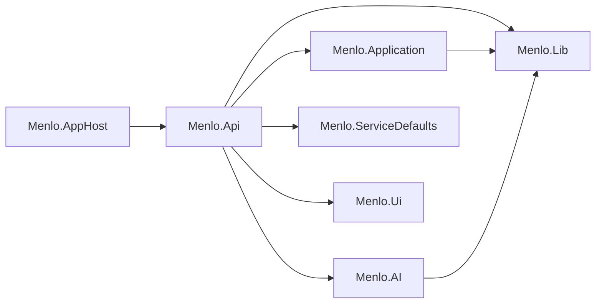

# Repository Structure

Where the code lives and how the projects depend on each other.

## Top level

| Path             | Holds                                                                                          |
| ---------------- | ---------------------------------------------------------------------------------------------- |
| `src/api/`       | The API host, the Aspire AppHost and the API tests.                                            |
| `src/lib/`       | The domain, persistence and AI libraries, their tests, and the Aspire service defaults.        |
| `src/ui/`        | The UI library (the design system) and its tests.                                              |
| `docs/`          | As-built documentation (see [the docs index](../README.md)).                                   |
| `deployment/`    | The production deployment guide, the reference compose file and the smoke check.              |
| `infra/`         | Bicep for the Azure resources CD uses (Key Vault and its certificate).                         |
| `scripts/`       | CI helpers, such as the API coverage guardrail and local `act` runs.                           |
| `.github/`       | Workflows, issue forms, rulesets and agent hooks.                                              |
| `.claude/skills/` | Repo skills for agents.                                                                       |
| `Dockerfile`     | Builds the production image: the API, which serves the UI (see [ADR-007](../decisions/adr-007-server-rendered-ui.md)). |

`Menlo.slnx` is the solution. `Directory.Build.props` sets the shared build settings and `Directory.Packages.props` holds the package versions (central package management).

## .NET projects

| Project                 | Path                          | Holds                                                                                                               |
| ----------------------- | ----------------------------- | ------------------------------------------------------------------------------------------------------------------- |
| `Menlo.Api`             | `src/api/Menlo.Api`           | The ASP.NET host: endpoints and handlers by feature (`Auth`, `Budget`), the pages under `Ui`, plus anti-forgery, forwarded headers and OpenAPI. |
| `Menlo.AppHost`         | `src/api/Menlo.AppHost`       | The Aspire AppHost for local development: the API, PostgreSQL and the llama.cpp server. |
| `Menlo.Lib`             | `src/lib/Menlo.Lib`           | The domain, by feature (`Auth`, `Budget`, `Users`), and the shared building blocks in `Common`. No infrastructure. |
| `Menlo.Application`     | `src/lib/Menlo.Application`   | EF Core persistence: `MenloDbContext`, the slice context interfaces, entity configurations, interceptors and migrations (see [Persistence](persistence.md)). |
| `Menlo.AI`              | `src/lib/Menlo.AI`            | Chat and vision services over the llama.cpp server.                                                                 |
| `Menlo.ServiceDefaults` | `src/lib/Menlo.ServiceDefaults` | Aspire service defaults: service discovery, resilience, health checks and OpenTelemetry.                                             |
| `Menlo.Ui`              | `src/ui/Menlo.Ui`             | The design system: tokens, components, layouts, charts and the gallery (see [Design System](design-system.md)). It references no other Menlo project. |

Each project except the AppHost and service defaults has a `.Tests` project beside it: `Menlo.Api.Tests`, `Menlo.Lib.Tests`, `Menlo.Application.Tests`, `Menlo.AI.Tests` and `Menlo.Ui.Tests`. See [How to test](../guides/testing-howto.md).

## The UI

The UI is server-rendered HTML in two places (see [UI Architecture](../explanations/ui-architecture.md)):

| Path | Holds |
| --- | --- |
| `src/ui/Menlo.Ui/Components` | The design-system components (`Mnl*.razor`), each with its `.razor.css`. |
| `src/ui/Menlo.Ui/Layouts` | The document, the [app shell](app-shell.md) and the layout primitives. |
| `src/ui/Menlo.Ui/Charts` | Server-rendered SVG charts. |
| `src/ui/Menlo.Ui/Gallery` | The component gallery served at `/design`. |
| `src/ui/Menlo.Ui/Utilities` | Pure helpers: money formatting and class names. |
| `src/ui/Menlo.Ui/wwwroot` | Tokens and base styles, `menlo.js`, and the vendored htmx and fonts. |
| `src/api/Menlo.Api/Ui/<Feature>` | A feature's pages, fragments, view models and endpoints (`Home`, `Budgets`, `Analytics`, `SignIn`, `Errors`, `Design`). |
| `src/api/Menlo.Api/Ui/Shared` | The page frame, rendering helpers, toasts, htmx response headers and form errors. |

There is no Node toolchain: no `package.json`, bundler or frontend build step.

UI tests are in `src/ui/Menlo.Ui.Tests` (components) and `src/api/Menlo.Api.Tests` (`Ui/` for pages and forms, `E2E/` for browser tests).
