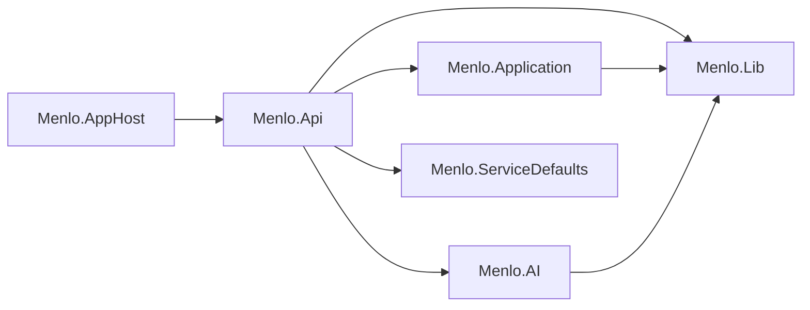

# Repository Structure

Where the code lives and how the projects depend on each other.

## Top level

| Path             | Holds                                                                                          |
| ---------------- | ---------------------------------------------------------------------------------------------- |
| `src/api/`       | The API host, the Aspire AppHost and the API tests.                                            |
| `src/lib/`       | The domain, persistence and AI libraries, their tests, and the Aspire service defaults.        |
| `src/ui/web/`    | The Angular workspace.                                                                         |
| `docs/`          | As-built documentation (see [the docs index](../README.md)).                                   |
| `deployment/`    | The production deployment guide, the reference compose file and the smoke check.              |
| `infra/`         | Bicep for the Azure resources CD uses (Key Vault and its certificate).                         |
| `scripts/`       | CI helpers, such as the API coverage guardrail and local `act` runs.                           |
| `.github/`       | Workflows, issue forms, rulesets and agent hooks.                                              |
| `.claude/skills/` | Repo skills for agents.                                                                       |
| `Dockerfile`     | Builds the production image: the API with the Angular app bundled in (see [ADR-005](../decisions/adr-005-bundled-spa-hosting.md)). |

`Menlo.slnx` is the solution. `Directory.Build.props` sets the shared build settings and `Directory.Packages.props` holds the package versions (central package management).

## .NET projects

| Project                 | Path                          | Holds                                                                                                               |
| ----------------------- | ----------------------------- | ------------------------------------------------------------------------------------------------------------------- |
| `Menlo.Api`             | `src/api/Menlo.Api`           | The ASP.NET host: endpoints and handlers by feature (`Auth`, `Budget`, `Endpoints/Onboarding`), plus anti-forgery, forwarded headers, OpenAPI and SPA hosting. |
| `Menlo.AppHost`         | `src/api/Menlo.AppHost`       | The Aspire AppHost for local development: the API, PostgreSQL, the llama.cpp server, the Angular dev server and the two Storybooks. |
| `Menlo.Lib`             | `src/lib/Menlo.Lib`           | The domain, by feature (`Auth`, `Budget`, `Onboarding`), and the shared building blocks in `Common`. No infrastructure. |
| `Menlo.Application`     | `src/lib/Menlo.Application`   | EF Core persistence: `MenloDbContext`, the slice context interfaces, entity configurations, interceptors and migrations (see [Persistence](persistence.md)). |
| `Menlo.AI`              | `src/lib/Menlo.AI`            | Chat and vision services over the llama.cpp server.                                                                 |
| `Menlo.ServiceDefaults` | `src/lib/Menlo.ServiceDefaults` | Aspire service defaults: service discovery, resilience, health checks and OpenTelemetry.                                             |

Each project except the AppHost and service defaults has a `.Tests` project beside it: `Menlo.Api.Tests`, `Menlo.Lib.Tests`, `Menlo.Application.Tests` and `Menlo.AI.Tests`. See [How to test](../guides/testing-howto.md).

## Angular workspace

`src/ui/web` is an Nx workspace with four projects under `projects/`:

| Project                 | Holds                                                                                                     |
| ----------------------- | --------------------------------------------------------------------------------------------------------- |
| `menlo-app`             | The app: routes, pages by feature (`budget`, `home`, `pages/onboarding`, `sign-in`), and `core/` for auth and onboarding. |
| `menlo-lib`             | The design system: `atoms`, `molecules` and `organisms` (including the [app shell](app-shell.md)), `foundations`, `pipes` and `theme`. |
| `data-access-menlo-api` | Typed API clients for the app.                                                                            |
| `shared-util`           | Framework-light utilities: the [Result pattern](angular-result-pattern-api.md) and `Money`.               |

The app imports the other three by package name (`menlo-lib`, `data-access-menlo-api`, `shared-util`). `tsconfig.json` maps those names to their builds in `dist/`, so a library must be built before the app sees its changes.

`e2e/` holds the Playwright tests. Unit tests sit next to the code as `*.spec.ts` and run with Vitest. Storybook stories sit next to the components as `*.stories.ts`.
