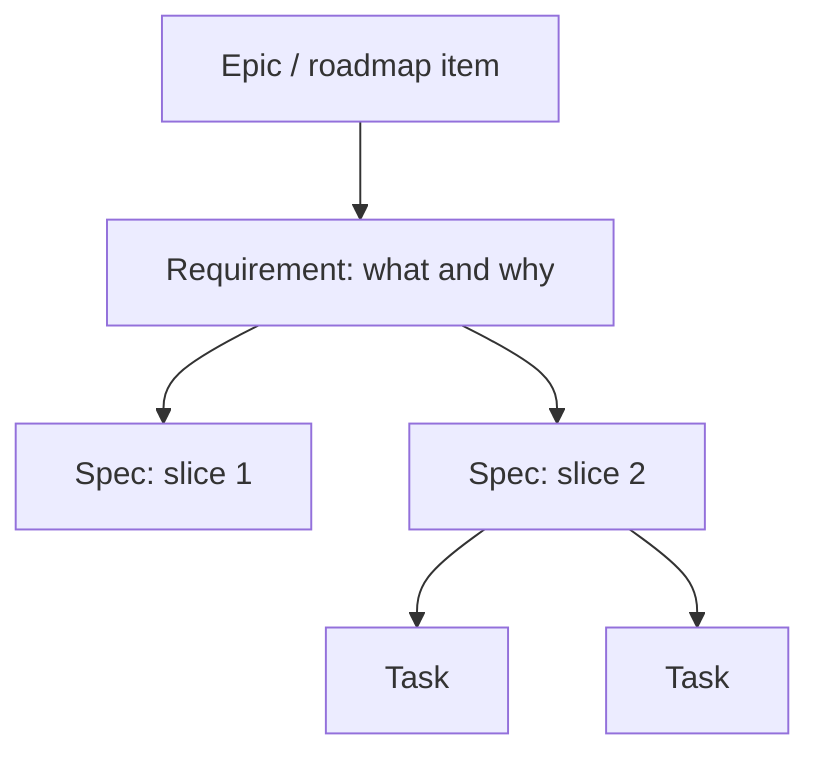

# Work Items: Requirements, Specs and Tasks

Menlo plans work in GitHub issues, tracked on the [Menlo Roadmap](https://github.com/users/DigiBanks99/projects/2) project. Issues hold intent. `docs/` holds as-built truth.

## The three levels

| Level           | Label         | Answers          | Contains                                                                                         | Parent                  |
| --------------- | ------------- | ---------------- | ------------------------------------------------------------------------------------------------ | ----------------------- |
| **Requirement** | `requirement` | What and why     | Problem, who it's for, outcomes, business rules, acceptance criteria, out of scope               | Epic or roadmap item    |
| **Spec**        | `spec`        | How (one slice)  | Domain model changes, API contract, UI flow, Mermaid diagrams, test cases, affected areas, risks | Requirement (sub-issue) |
| **Task**        | `task`        | One unit of work | A checklist                                                                                      | Spec (sub-issue)        |

- Open a Requirement or Spec with its issue form. The form applies the label, and the label adds the issue to the project.
- A Spec is a slice that ships on its own. Split a Requirement into several Specs rather than writing one large Spec.
- Create Tasks only when a Spec is too big for one PR. Most Specs have none.
- There are no implementation plans. The agent or developer plans when they pick up a Spec.

## Definition of Ready

A Spec can be picked up (Status: **Ready**, and labelled `ready-for-agent` if an agent can take it) when:

- [ ] It is a sub-issue of a Requirement, and that Requirement has acceptance criteria
- [ ] The slice is small enough to ship on its own, or is split into Tasks
- [ ] The domain model changes, API contract and UI flow are described, or marked not applicable
- [ ] Test cases cover each acceptance criterion it implements
- [ ] Affected areas (projects, endpoints, screens, migrations) are listed
- [ ] Open questions are resolved; risks have a mitigation or are accepted
- [ ] Priority, Area and Phase are set on the project

## Definition of Done

### Every change

Each PR, whatever level it belongs to:

- [ ] The solution builds
- [ ] All tests pass
- [ ] New or changed behaviour has new tests
- [ ] Linting and formatting pass (`dotnet format`, `pnpm lint`, `pnpm format`)
- [ ] Changed files under `src/api/Menlo.Api/**` keep at least 70% line coverage
- [ ] Commits follow conventional commits and reference the issue

### Spec

- [ ] Every PR for the Spec meets "Every change"
- [ ] Its test cases are implemented and passing
- [ ] Its Tasks, if any, are closed
- [ ] As-built docs in `docs/` are updated for what changed

### Requirement

A Requirement can be closed when:

- [ ] All its Spec sub-issues are closed
- [ ] Every acceptance criterion is checked off and verified in the running app
- [ ] As-built docs in `docs/` describe the shipped behaviour
- [ ] Anything left out is captured as a new Requirement or listed under "Out of scope"

## Issue or doc?

Issues hold intent: what we want and how we plan to build it. `docs/` holds as-built truth: how the system works today.

| Situation                                                      | Update                                                |
| -------------------------------------------------------------- | ----------------------------------------------------- |
| Scope, acceptance criteria or approach changes before shipping | The Requirement or Spec issue                         |
| A question is answered or a decision made while refining       | The issue body (not only a comment)                   |
| Behaviour ships                                                | The as-built docs in `docs/`                          |
| A significant architectural decision is made                   | An ADR in `docs/decisions/`                           |
| Shipped behaviour needs to change                              | A new Requirement or Spec, then `docs/` when it ships |

Once a Requirement is closed, `docs/` is the source of truth. Don't edit closed issues to reflect later changes.
