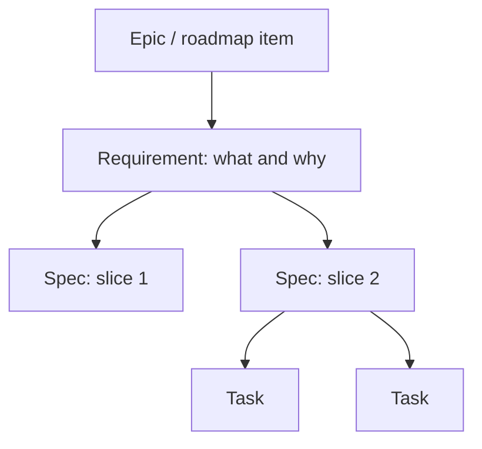

# Work Items: Requirements, Specs and Tasks

Menlo plans work in GitHub issues, tracked on the [Menlo Roadmap](https://github.com/users/DigiBanks99/projects/2) project. Issues hold intent. `docs/` holds as-built truth.

## The three levels

| Level           | Label         | Answers          | Contains                                                                                                    | Parent                  |
| --------------- | ------------- | ---------------- | ----------------------------------------------------------------------------------------------------------- | ----------------------- |
| **Requirement** | `requirement` | What and why     | Problem, who it's for, outcomes, business rules, acceptance criteria, out of scope                          | Epic or roadmap item    |
| **Spec**        | `spec`        | How (one slice)  | Domain model changes, API contract, UI flow, Mermaid diagrams, decisions, test cases, affected areas, risks | Requirement (sub-issue) |
| **Task**        | `task`        | One unit of work | A checklist                                                                                                 | Spec (sub-issue)        |

- Open a Requirement or Spec with its issue form. The form applies the label, and the label adds the issue to the project.
- A Spec is a slice that ships on its own. Split a Requirement into several Specs rather than writing one large Spec.
- Create Tasks only when a Spec is too big for one PR. Most Specs have none.
- There are no implementation plans. The agent or developer plans when they pick up a Spec.



## Bugs and tech debt

Some work isn't a slice of a feature, so it has no Requirement above it. It is one of two kinds, kept apart because they tell different stories:

| Kind          | Label       | What it is                                                                                                                      |
| ------------- | ----------- | ------------------------------------------------------------------------------------------------------------------------------- |
| **Bug**       | `bug`       | Menlo, or a doc, contradicts the intended behaviour. Resolving it restores the intent. A doc that is wrong is a bug.            |
| **Tech debt** | `tech-debt` | Work deliberately deferred, or missed, that serves developers and testers rather than the household. |

Tech debt includes:

- missing or slow tests
- missing documentation
- dev and test conveniences, such as a quick configure step or a clear-cache command
- risks consciously accepted to ship, such as a security shortcut, logged so someone comes back to them

A tech debt issue records its origin: what was deferred or missed, in which PR or decision, and any risk that was accepted.

- Open one with the Bug or Tech debt issue form, and make sure it is on the project.
- Each goes from **Backlog** to **Refining** when the way forward isn't clear, and to **Ready** once it meets the [Definition of Ready for bugs and tech debt](#ready-bugs-and-tech-debt).
- If resolving one would change intended behaviour, it isn't a bug or tech debt. It becomes a Spec under the Requirement it belongs to, or a new Requirement.

## Shaping a Requirement

A Requirement starts as a stub and is shaped until its Specs are ready for an agent. Shaping keeps the whole of Menlo in view, as the [Product Vision](../explanations/product-vision.md) describes it. A Requirement is never shaped on its own.

1. **Stub** (Status: **Backlog**). It has the problem, who it's for and draft outcomes, plus a section for each whole-of-Menlo question below, which may still be open. Set its **Area** to the feature or capability it belongs to.
2. **Pick it up** (Status: **Refining**). Decide whether the way is clear:
   - If it is clear, fill in the outcomes, business rules and acceptance criteria with `/to-requirement` in one grilling session.
   - If it is foggy, chart a map from the Requirement with `/wayfinder` and work through it until the way is clear.
3. **Break it into Specs** with `/to-specs`.
4. **Each Spec meets the [Definition of Ready](#definition-of-ready)**, then moves to **Ready** and gets `ready-for-agent`.
5. **Build it** with `/work-on-spec`.

The stage is shown by Status alone; there is no shaping label. The **Needs shaping** view on the project lists `label:requirement` in Backlog or Refining.

### Whole-of-Menlo questions

Every Requirement answers these before its Specs can be Ready:

- **Features:** which other features does it touch, and how? A spend affects the budget; an event may cost money.
- **The agent:** what can the agent do here? Does it need tools for this? Can it interpret or map, and can it only propose, or also commit? Does that need a new concept, such as staging what it imported?
- **Lists:** should lists feed into it?
- **Notifications:** what does it tell the household, and when?

## Definition of Ready

A Spec can be picked up (Status: **Ready**, and labelled `ready-for-agent` if an agent can take it) when the checklist below is met. Agents only pick up issues that have both.

- [ ] It is a sub-issue of a Requirement, and that Requirement has acceptance criteria
- [ ] That Requirement answers the [whole-of-Menlo questions](#whole-of-menlo-questions)
- [ ] The slice is small enough to ship on its own, or is split into Tasks
- [ ] The domain model changes, API contract and UI flow are described, or marked not applicable
- [ ] Test cases cover each acceptance criterion it implements
- [ ] Affected areas (projects, endpoints, screens, migrations) are listed
- [ ] Every decision the implementation depends on is answered under Decisions, or in the Requirement
- [ ] Open questions are resolved; risks have a mitigation or are accepted
- [ ] Priority, Area and Phase are set on the project

### Ready: bugs and tech debt

A bug or tech debt issue can be picked up when:

- [ ] It states the problem, and for tech debt, its origin
- [ ] It says what "done" looks like: the expected behaviour for a bug, the outcome for tech debt
- [ ] Affected areas (projects, files, endpoints, screens) are listed
- [ ] The way forward is clear: no decision is open and nothing is ambiguous
- [ ] It ships in one PR
- [ ] Resolving it doesn't change intended behaviour
- [ ] Priority, Area and Phase are set on the project

An agent may move it to **Ready** and add `ready-for-agent` when every item is met. If anything is still ambiguous, it isn't Ready: move it to **Refining** and comment what needs deciding.

## Definition of Done

### Every change

Each PR, whatever level it belongs to:

- [ ] The solution builds
- [ ] All tests pass
- [ ] New or changed behaviour has new tests
- [ ] Linting and formatting pass (`dotnet format`, `pnpm lint`, `pnpm format`)
- [ ] Changed files under `src/api/Menlo.Api/**` keep at least 70% line coverage
- [ ] Commits follow conventional commits and reference the issue

### Spec

- [ ] Every PR for the Spec meets "Every change"
- [ ] Its test cases are implemented and passing
- [ ] Its Tasks, if any, are closed
- [ ] As-built docs in `docs/` are updated for what changed

### Bug or tech debt

- [ ] Its PR meets "Every change"
- [ ] A bug in code has a test that fails without the fix
- [ ] As-built docs in `docs/` are updated for what changed

### Requirement

A Requirement can be closed when:

- [ ] All its Spec sub-issues are closed
- [ ] Every acceptance criterion is checked off and verified in the running app
- [ ] As-built docs in `docs/` describe the shipped behaviour
- [ ] Anything left out is captured as a new Requirement or listed under "Out of scope"

## Issue or doc?

Issues hold intent: what we want and how we plan to build it. `docs/` holds as-built truth: how the system works today.

| Situation                                                      | Update                                                |
| -------------------------------------------------------------- | ----------------------------------------------------- |
| Scope, acceptance criteria or approach changes before shipping | The Requirement or Spec issue                         |
| A question is answered or a decision made while refining       | The issue body (not only a comment)                   |
| Behaviour ships                                                | The as-built docs in `docs/`                          |
| A significant architectural decision is made                   | An ADR in `docs/decisions/`                           |
| Shipped behaviour needs to change                              | A new Requirement or Spec, then `docs/` when it ships |

Once a Requirement is closed, `docs/` is the source of truth. Don't edit closed issues to reflect later changes.

## Agents and issues

Agents plan and pick up work with the global `to-requirement`, `to-specs` and `work-on-spec` skills, configured in `AGENTS.md`.

- Agents comment progress on the issue they are working on.
- **While shaping** (planning, triage, wayfinding, refinement), agents may edit Requirement and Spec bodies to record what the owner decided. Each edit gets a comment that says what changed and why. Work is being shaped while the Requirement is open and neither it nor any of its Specs is **In progress** or **Done** on the project.
- **Once building starts**, from the moment the Requirement or any of its Specs is **In progress**, agents edit a Spec or Task section only when a PR changes the plan, such as a decision taken or the approach changed. Each edit gets a comment that says what changed, why, and links the PR. They don't edit the Requirement body: the what and why are settled with the owner, so agents suggest changes in a comment.
- They never edit a closed issue, and never add or change an owner-approval line.
- They close issues only through `Closes #<n>` in a PR.

The label usually adds a new issue to the project. `item-add` is safe to run either way, because it returns the existing item. To add issue `n` and mark it Ready:

```shell
n=123
url=$(gh issue view "$n" --json url --jq .url)
item=$(gh project item-add 2 --owner DigiBanks99 --url "$url" --format json --jq .id)
gh project item-edit --id "$item" --project-id PVT_kwHOAAOZw84BpUot \
  --field-id PVTSSF_lAHOAAOZw84BpUotzhnwyG8 --single-select-option-id a3e2ab66
gh issue edit "$n" --add-label ready-for-agent
```

Leave out the last two commands to only add it. The IDs are the project's Status field and its Ready option; look them up with `gh project field-list 2 --owner DigiBanks99 --format json` if they stop working.
