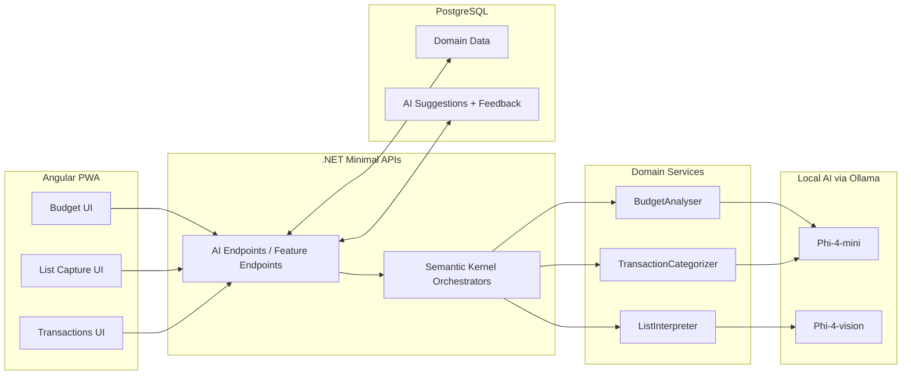

# AI Infrastructure — Component & Data Flow

> **Historical:** the Ollama and Semantic Kernel stack described here was replaced by llama.cpp and Microsoft Agent Framework. See [ADR-006](../../../decisions/adr-006-llamacpp-and-agent-framework.md). The rest of this document is left as written.

